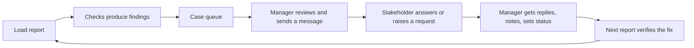
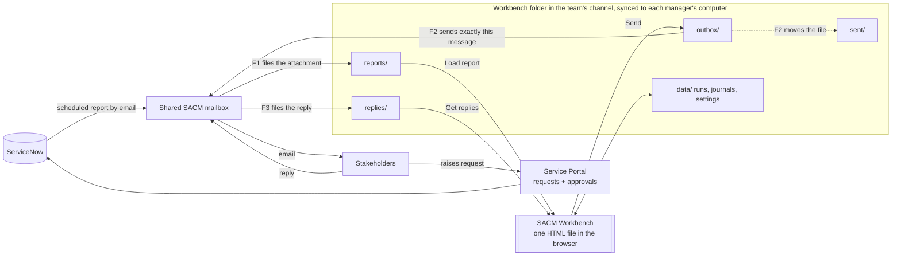

# Architecture

How the Workbench is built: its parts, its layers, every module, which module may use which, how data flows, and how it stays safe. Why the app exists is in [CONTEXT.md](CONTEXT.md); the screens are in [FEATURES.md](FEATURES.md); the SACM rules are in [DOMAIN-RULES.md](DOMAIN-RULES.md); the files of the team folder, field by field, are in [DATA-MODEL.md](DATA-MODEL.md); how to add a check, a report type or a screen is in [HOW-TO.md](HOW-TO.md). Every decision has its number in [DECISIONS.md](DECISIONS.md).

## 1. In one picture

A web app for SACM managers. It reads the reports the team already gets, finds the data quality problems, shows them in one shared queue, knows who to ask, prepares the message, shows the replies and keeps the history for the whole team.

**Nothing happens on its own.** A report is read when a manager presses *Load*. A message goes out when a manager presses *Send*. Replies are shown when a manager presses *Get replies*.



## 2. Principles

| # | Principle | Consequence |
|---|---|---|
| P1 | **The manager decides, the tool prepares** | No scheduled sending, no status a person would not expect. The only automatic conclusion is "the problem is gone from the report". |
| P2 | **ServiceNow is the only place where CMDB data changes** | The tool never writes to the CMDB, EPO or Solusi. |
| P3 | **A check is a module** | Detection, audience and message text are data in `checks/`. A new rule is normally a new check file. |
| P4 | **One shared memory** | Everything a manager does is recorded with name and time, and every colleague sees it. |
| P5 | **Fix where the data is born** | Values that come from EPO, the vendor import or Solusi are corrected at the source. |
| P6 | **Closed means verified** | A case is *Verified* only when a later report contains the CI, could test the check and no longer shows the problem. |
| P7 | **Only what we already have** | Microsoft 365, the shared mailbox, Teams, ServiceNow. No servers, no new licences. |
| P8 | **Company data stays in the tenant** | The app makes no network connection. This repository holds code and invented samples only. |
| P9 | **The process is the specification** | Roles, approval rules and criticality rules come from the SACM process documentation ([PROCESS-BASELINE.md](PROCESS-BASELINE.md)). |
| P10 | **Same input, same bytes** | Every file the app writes depends only on what it read, never on "now" or "me". Two computers that do the same thing write the same file, so OneDrive keeps one. |

The Power BI report (§12) keeps P1 to P6, P9 and P10. For P7 and P8 it uses what the company already has (Power BI Premium Per User, SharePoint, Power Automate, D268) and connects only to the team's SharePoint site in the tenant; reports load by a refresh, sending stays a button (D269).

## 3. The parts



| Part | What it is | Technology |
|---|---|---|
| **App** | The whole user interface and all logic. Opened from the synced folder. | One HTML file (`app/SACM-Workbench.html`), built with React, Vite and Tailwind; the logic is plain TypeScript. Edge or Chrome. |
| **Team folder** | Shared memory and the exchange point with the mailbox. Its files: [DATA-MODEL.md](DATA-MODEL.md). | A folder in the channel's library, synced with OneDrive. |
| **Three small flows** | The bridge to the shared mailbox. They hold no logic and take no decisions. Steps: [SETUP.md](SETUP.md). | Power Automate, standard connectors. |
| **ServiceNow** | Source of the reports; the only place where data changes. | Scheduled reports; requests in the Service Portal. |

| Flow | Trigger | Does |
|---|---|---|
| F1 File reports | An email with a report arrives in the shared mailbox | Saves the attachment in `reports/` |
| F2 Send from outbox | A manager pressed *Send*: a file appears in `outbox/` | Sends that message, unchanged, from the shared mailbox; moves the file to `sent/` |
| F3 File replies | An email with one of our references in its subject arrives | Saves sender, time, subject and text in `replies/` |

Without the flows the app still works: reports can be picked as files, messages can be opened as a draft in Outlook, and the manager writes the answer as a note.

The app has three modes: the **team folder** (the shared memory), **report files only** (in memory, nothing is saved) and **invented data** (the demo, in memory). The two in-memory modes use the same code with an in-memory folder (`MemoryWorkspace`).

## 4. Layers

```
checks/            the rules, as data: one file per check (packs/<subject>/) and the reference data (reference/)
src/core/          the logic: pure TypeScript, no browser, no Node, no library
src/app/           the browser part
  platform/          folder access, file reading, what Vite packs into the page
  state/             the state and the actions a manager takes (no screen, no library)
  view/              what the screens show (pure)
  ui/                parts several screens share
  screens/<screen>/  one folder per screen
  shell/             the top bar and the start screen: the only part that imports the screens
src/hosts/cli.ts   the command line, for development and tests
```

Each layer may use only the layers above it in this list, and the logic uses nothing but itself. Five design rules are checked by `tests/architecture.test.ts` on every `npm test`:

1. **The logic never uses the screens, the browser or Node.** `src/core/` imports only `src/core/`, and uses no browser or Node object.
2. **The centre does not know the features.** `model/`, `shared/`, the engine and finding states of `checks/`, and `cases/` import no report type, no team, audit or review module. They reach the checks of a report type only through the one list of detectors (`src/core/checks/detectors/index.ts`).
3. **What the screens show is pure.** `src/app/view/` imports the logic and other view files only.
4. **A screen does not import another screen.** Shared parts live in `src/app/ui/`; only `src/app/shell/` imports the screens.
5. **The actions import no screen and no library.** `src/app/state/` uses React only in `use-store.ts`, and gets the check packs and samples through `content.ts`, so the actions run under `node:test` with the in-memory folder.

None of these rules has an exception today; the test fails on a new one.

## 5. Module map

Every module of `src/`, by folder. Tests use the same folders under `tests/` (`tests/core/…`, `tests/app/state/`, `tests/app/view/`, `tests/tools/`).

### `src/core/model/`

| Module | Holds |
|---|---|
| `model.ts` | The shared types: CI, person, check pack, rule condition, message texts, finding, fix line, run result; the three modules; the finding states; the contract key (`contract:`) and the Procurement contact |

### `src/core/shared/`

| Module | Holds |
|---|---|
| `dates.ts` | Dates as ISO text, Excel date numbers, business days; the one way a date is written: `screenDate` ("12 Nov 2026"), `longDate` ("12 November 2026"), `datesInText` |
| `names.ts` | Names, the CI identity key (`nameKey`, `identityKey`) and the characters nobody can see |
| `text.ts` | Base64 to text without platform helpers, `plural`, and the words for report columns in notes (`columnWord`, `missingColumns`) |

### `src/core/reading/`

| Module | Holds |
|---|---|
| `csv.ts` | The CSV reader (quoting; comma, semicolon or tab found from the header line) |
| `xlsx.ts` | The `.xlsx` reader, no library: the zip directory and the sheet XML (element prefixes such as `<x:row>` dropped, D350); the host passes the one unzip step |
| `headers.ts` | How a column header is compared (lower case, `_`; the `ci.` prefix of a CMDB Health result is kept, D341) |
| `table.ts` | A file as a table; `ReportType`; knowing the type of a report from its columns (`recogniseAmong`) |

### `src/core/sources/`

One folder per report type: its definition (a `ReportType`), its reader and its comparison with the CI report.

| Module | Holds |
|---|---|
| `report-types.ts` | `REPORT_TYPES`, the one list of report types (the order of the tiles); `KNOWN_FILES`, the files known but not used (D341, D342); `recogniseReport`, `fileKind`; `folderFixes`, the box *What to fix in the folder* of the Power BI report (D352); `unhandledKind`, the last branch of every "one branch per type" in the hosts |
| `ci/ci-report.ts` | The CI report (`cmdb_ci` export or CMDB Health result) read into CIs |
| `relationships/relationship-report.ts` | The Relationship report (`cmdb_rel_ci`), and matching its ends to CIs |
| `epo/epo-report.ts` | The EPO systems report, and its comparison with the Service Instances |
| `contracts/contract-reports.ts` | The Solusi contract file and the ServiceNow contract report, and their comparison |
| `contracts/contract-changes.ts` | The page Contract changes: two Solusi files compared |

### `src/core/checks/`

| Module | Holds |
|---|---|
| `engine.ts` | `runChecks`: runs every check pack on one CI report. Pure: same input, same findings, same keys. The rule operators. `compareRuns` for the command line |
| `check-files.ts` | The validator of the check files (fields, rule words, detectors, classes, requests, references) |
| `parked.ts` | Parked classes (reference/parked-classes, D179): which CIs and parts of checks give no line yet, and the grey lines of the first screen |
| `finding-states.ts` | To solve, to review, waiting or known, from the reference data; the chips next to a CI |
| `detectors/index.ts` | The one list of code detectors, by family, `EngineInputs`, the named inputs of the engine, and `afterChecks`, the step a report type runs on the findings once every check ran |
| `detectors/output.ts` | What a detector gives back |
| `detectors/ci-detectors.ts` | Checks that need only the CI report: name rules, EPO ID, days in a status |
| `detectors/relationship-detectors.ts` | The relationship checks, on the relationship model |
| `detectors/criticality-detectors.ts` | The criticality checks that need the parents of a CI: above the parents, no criticality reaches the CI (relationships excluded from calculation pass nothing) |
| `detectors/epo-detectors.ts` | The EPO checks |
| `detectors/process-detectors.ts` | The stages of a Business Process in Ready (D197): waits for the BIA (a note), to map (a note: it is on the mapping backlog), or mapped (make it Operational) |
| `detectors/mapping-detectors.ts` | The mapping backlog (D200): one line per CI to map, with every reason (rules of the relationship model, and the tag rule of reference/mapping-backlog) |
| `detectors/source-first.ts` | The source first (D190): after the checks ran, the people lines of a CI from EPO are compared with the EPO systems report; a line waits, says what EPO holds, or a leftover gets its line |
| `detectors/contract-detectors.ts` | The contract checks: Not in Solusi, To clear by hand, Contract status, Upload check, and the problems of the contract data (For Procurement, Contracts to fix in ServiceNow) |

### `src/core/cases/`

| Module | Holds |
|---|---|
| `cases.ts` | `buildRun` (a run from a result: who is asked, by which route), `buildCases` (cases from runs, journals and replies), `groupCases` (shared cases), the statuses, the scores |
| `contact.ts` | Who to ask about a finding, and who to escalate to: the manager, else the department head; for a Managed by person, the owner of the CI |
| `record-teams.ts` | Teams that are the contact for the record of a class (reference/record-teams, D195): Process Management for a Business Process; the addresses of a team from the settings |
| `fix-place.ts` | Where a fix is made: in EPO (Business Service, Service Instance, an offering the EPO integration created) or in ServiceNow (D122, D123) |
| `record-search.ts` | Where the record of a line of a SACM list is found in ServiceNow: the address of the team's ServiceNow, and the link to the CI, the relationship rows or the contract (D244) |
| `inventory.ts` | The inventory a run keeps for the lifecycle review |
| `replies.ts` | A reply file read; the reference in a subject; an email body as text |

### `src/core/mapping/`

| Module | Holds |
|---|---|
| `mapping/backlog.ts` | The mapping backlog as a manager works it (D201, D203): the stages of each class, the stage of a case, the mark "The process does not exist" and when Process Management was told |
| `mapping/capability-sheet.ts` | The capability sheet (D205): every Business Capability with what is above and below it, worked out when the report is loaded |

### `src/core/messages/`, `team/`, `memory/`, `audit/`

| Module | Holds |
|---|---|
| `messages/messages.ts` | The email and Teams texts in the style of the SACM templates; `REQUESTS`; parts of at most 25 CIs; a reminder with new points as one email; escalation drafts |
| `team/team.ts` | The team list, sharing out a card, My work, Since your last visit, the double-contact warning |
| `team/conflict-copies.ts` | Tidying the copies OneDrive makes when two computers write the same file |
| `memory/memory.ts` | Keeping the shared memory small: what is active, what is archived, `state.json` |
| `memory/finder.ts` | The newest report of each type among the files of the folder; `chooseReports`, the file of one type and day chosen by its content (D348); run file names |
| `audit/audit.ts` | The verification record of a load, the audit export of a period, *Not followed up* |
| `audit/lifecycle-review.ts` | The lifecycle review: drawing the sample, the answers, the cases it opens |

### `src/app/platform/`

| Module | Holds |
|---|---|
| `workspace.ts` | The team folder: `FolderWorkspace` (the browser's folder access) and `MemoryWorkspace` (in memory), behind one `Workspace` interface |
| `files.ts` | Reading a picked file in the browser (`DecompressionStream` for `.xlsx`) |
| `bundle.ts` | What Vite packs into the page: the check packs, the reference data, the invented samples |

### `src/app/state/`

| Module | Holds |
|---|---|
| `store.ts` | The state object the screens read; `rebuild` (runs, cases and groups worked out again); `changed`, `update`, `toast` |
| `use-store.ts` | The one link to React: re-render when the state changes |
| `content.ts` | The check packs, reference data and samples the actions use (set once at start in `main.tsx`) |
| `folder.ts` | Opening the folder, *Refresh*, and the upkeep of the shared memory (`maintain`) |
| `folder-files.ts` | Reading runs, the archive, journals, replies and `state.json` |
| `conflicts.ts` | Tidying the conflict copies found in the folder |
| `loading.ts` | Loading reports (*Load*, *Choose reports*, files, the demo), *Remove* a load |
| `journal.ts` | Writing an event to the journal of the manager |
| `messages.ts` | Handing a message to `outbox/`, recording a sent message (and making the group mine), *Get replies*, reading a colleague's sent message |
| `team.ts` | The team list, Since your last visit, the double-contact warning |
| `settings.ts` | Who is working (kept in the browser) and the team settings |
| `audit.ts` | *Not followed up*, and the history the audit export reads |
| `review.ts` | Starting a lifecycle review and recording the answers |

### `src/app/view/`

| Module | Holds |
|---|---|
| `cards.ts` | One card per check: its kind (`cardKind`: owners, fix list, review list, one mailbox, mapping backlog), its light (red, green, grey, review, marked) and its counts; its subject (`topicOf`), the order of the cards (`orderCards`) new and solved since the report before (`sinceReport`), the words of a section header (`sectionText`) and the one number and fact of a card (`cardLine`) |
| `myday.ts` | My day (D216): the rows of the four boxes (replies to read, reminders due, to escalate, new since the last report) |
| `groups.ts` | The cases of a card by owner (or by kind for contracts), the group "nobody" by reason; search, sort, the Teams link; the next step of a group (`nextStep`) |
| `cases.ts` | What a case shows: closed or to solve, what was done, what SACM still has to do; the replies to read |
| `people.ts` | The people of a CI as shown, and the run as the app saves it (`AppRun`, `people`) |
| `person.ts` | The page of a person contacted |
| `fix-list.ts` | The SACM fix list: its lines, who marked them, its groups, one record per CI with all its changes (D242) |
| `exports.ts` | The CSV exports, also the mapping backlog and the capability sheet |
| `tiles.ts` | The Reports strip: one tile per report type, and the one Reports line above them (`reportsLine`) |
| `activity.ts` | Events in words, for timelines and the Activity page (what was done and who did it, apart) |
| `setup.ts` | Settings: the set-up list (`setupSteps`) and the lines a change writes to Activity (`settingsLines`) |
| `contracts.ts` | What the contract cards show besides their cases |
| `backlog.ts` | What the page Mapping backlog shows: one line per CI to map, its stage, the criticality lines of the CI, the lines to tell Process Management and their message |

### `src/app/ui/`, `src/app/screens/`, `src/app/shell/`

| Module | Holds |
|---|---|
| `ui/basics.tsx` | The base parts of the look ([LOOK.md](LOOK.md)): buttons, the icon button, icons, the logo, the state badge, the status chip, the filter chip, windows, fields, the pages of a long list |
| `ui/parts.tsx` | The other parts of the look: tabs, segmented control, counter, notice, empty state, fold sign, the fold of a list (*Waiting 1*), menu button and its lines, filter chip, count badge, tick box, initials, date field, table, long text, and the one tooltip of the page (`TipLayer`) |
| `ui/icons.ts` | The Workspace icons (73), one meaning each |
| `ui/fonts/` | The font Nunito Sans (three weights), packed into the page by the build |
| `ui/ConfirmDialog.tsx` | The app's own question before an action on many things |
| `ui/people.tsx` | The person link, the Assign menu (*Take*, *Assign to*), the double-contact warning |
| `ui/servicenow.tsx` | SACM's hand work in ServiceNow: **Copy** the value to set (D243) and **ServiceNow**, the record in a new tab (D244); fix list and case panel |
| `ui/ComposeDialog.tsx` | The email window: the drafts as tabs, one footer (*Send from mailbox*, *Outlook*, *More*) |
| `ui/TeamsDialog.tsx` | *Teams chat* |
| `ui/ExceptionDialog.tsx` | *Not followed up* |
| `ui/PageHead.tsx` | The head of a page |
| `ui/download.ts` | Saving a file to Downloads |
| `ui/labels.ts` | Words several screens show |
| `ui/stages.tsx` | The stages of a mapping case: the dots, and the buttons that set it (page Backlog, case panel) |
| `screens/myday/MyDay.tsx` | My day (D216): the page head with the Reports line, the four boxes, or one line of counters when folded; the outbox list |
| `screens/overview/Overview.tsx` | All cards: the filter row (Search, subject, Filter menu, Cards or Lines), three sections of cards in their order, and the plain list of cards beside an open card |
| `screens/card/CardView.tsx` | An open card: only picks the screen of its kind |
| `screens/card/CardHead.tsx` | The head every card shares (title, what to do, *Details*, numbers, D223), the one toolbar of every card (Search, Filter, the actions, D224), and the one sentence of a card with nothing to do |
| `screens/card/OwnerCard.tsx` | The kind Owners: owner groups, and the part SACM checks first |
| `screens/card/FixListCard.tsx` | The kind SACM fix list: lines by group and page, a tick box per line, *Mark N fixed*, *Fixed*, *Undo* (D233) |
| `screens/card/ReviewListCard.tsx` | The kind Review list: lines to look at |
| `screens/card/MailboxCard.tsx` | The kind One mailbox: one message, its step in the toolbar (D231), a table per kind of problem |
| `screens/card/GroupCard.tsx` | The parts the card screens share: one owner group (its head, D226), *Share out*, the notes, the quiet lists under a card (D230) |
| `screens/card/CiTable.tsx` | The one table part of a card: the CIs of a group, the plain lines of a folded list, a line that opens its case, *Missing* or "–" (D229) |
| `screens/case/CasePanel.tsx` | The case panel: one CI, its problems as boxes, people and timeline, and the bar at the bottom (D232) |
| `screens/reports/Reports.tsx` | The Reports line with its tiles (*Show*), the message of the load, and *Choose reports* |
| `screens/audit/Audit.tsx` | The Audit page |
| `screens/contracts/Contracts.tsx` | The page Contract changes |
| `screens/backlog/Backlog.tsx` | The page Mapping backlog (D200): the lines, filters by state and stage, *Invite*, *Tell Process Management*, *Export*, *Capability sheet*. The shell also shows it for the card *Mapping backlog* |
| `screens/team/Pages.tsx` | My work (replies to read, then the table of what is assigned), Activity (a table), a person's page |
| `screens/team/HandOver.tsx` | *Hand over* |
| `screens/settings/Settings.tsx` | Settings: four parts (Set-up, Me, Team, Mailboxes), "Not saved yet" and the question before closing |
| `screens/settings/TeamEditor.tsx` | Settings → Team |
| `screens/settings/TeamPeopleEditor.tsx` | Settings → Mailboxes: the name and the people of a team of reference/record-teams (Process Management) |
| `shell/App.tsx` | The header (one row: pages, *Load*, the menu *More*, Settings, theme, initials), the start screen, which screen is shown |
| `shell/Notes.tsx` | The strips above the screens |
| `main.tsx` | Start: hands the packed content to the state and shows the shell |
| `index.html`, `styles.css` | The page (with its Content-Security-Policy and the tab icon) and the styles: the named colours light and dark, the font, the corners (Tailwind, with its own colours switched off) |

### `src/hosts/`, `tools/`, `tests/`

| Module | Holds |
|---|---|
| `src/hosts/cli.ts` | `node src/hosts/cli.ts <reports>`: the checks on files, a summary, `findings.json` |
| `tools/build-app.mjs` | `npm run build`: validates the check files, builds the one HTML file, fails if anything is not inline |
| `tools/checks-doc.ts` | `npm run docs`: writes [CHECKS.md](CHECKS.md) from the check files |
| `tools/placeholders.ts` | `npm run placeholders`: lists the stand-ins of `tools/placeholders.json` and fails on a stale entry or an unlisted placeholder; `npm run docs` writes [PLACEHOLDERS.md](PLACEHOLDERS.md) with it |
| `tools/record-samples.ts` | `npm run record`: writes the recorded result of the invented samples (`tests/recorded/`) |
| `tools/privacy-guard.ts` | `npm run privacy`: fails on a link, a host or an email address that is not invented |
| `tools/repository-rules.ts` | `npm run rules`: fails when a copied skill file differs from `.claude/skills/upstream.json` (listed by source), a pinned skill tool has two versions, a `GLOSSARY.md` or `docs/adr/` exists, or a `.pbix` or a Power BI cache or personal settings file is committed |
| `tools/powerbi/` | The tools of the Power BI report (§12): `generate.ts`, `tmdl.ts`, `lint.ts` with `tmdl-check/` and `schemas/`, `connector.ts`, `units.ts`, `parity.ts` |
| `tools/fingerprint.ts` | Counts and checksums of real files, to prove a change gives the same result (output never committed) |
| `tests/architecture.test.ts` | The design rules of §4 |
| `tests/sample-record.ts` | The recorded result: findings, cases, cards, groups, messages, exports of the invented samples |
| `tests/docs.test.ts` | Every relative link of the documents resolves, and this page names every module |
| `tests/browser/` | `npm run browser`: pilot (two managers at once), EPO, contracts, criticality, relationships, lifecycle, tags and Settings, numbers, times and words, messages and follow-up, each card as its kind, the first screen, Settings and Audit, and the look (four sizes, light and dark), in a headless browser on invented data |

## 6. How data flows

### Loading a report

1. The app reads the file into a table (`reading/`) and knows its type from its columns, never from its name (`recogniseReport`).
2. A Relationship report, an EPO systems report or a contract file is read by its reader and saved as a load in its folder of `data/runs/`. Its checks run when a CI report is loaded, with the newest load of each type made with it or before it.
3. A CI report is read into CIs. `runChecks(cis, columns, packs, references, { date, relationships, epo, contracts })` gives the findings, what was tested, how many CIs each check saw, and the notes on what could not be tested. A check that cannot be evaluated always gives a note, never a silent pass.
4. `buildRun` adds to each finding who to ask, by which route, who is copied, who an escalation goes to, the CI as the message table shows it, and its state (to solve, to review, waiting, known). The run is saved in `data/runs/`.
5. The load is written to the journal of the manager (event `report`), and the upkeep runs (§6.3).

### Working out the cases

Cases are never stored. Each time the folder is read, `rebuild` (`src/app/state/store.ts`) works them out from what is stored:

- **runs**: the last 10 CI runs, plus the summary of older ones in `data/state.json`;
- **events**: the journals of every manager, from the month of the oldest active run on;
- **replies**: the files in `replies/`, matched to a message by the reference in their subject.

`withReviewFacts` first adds the findings opened by the lifecycle review. `buildCases` gives one case per finding: its status, messages, replies, notes, who has it, whether a reminder is due. `groupCases` makes the shared cases (one check, one contact, one route). The view (`src/app/view/`) turns them into cards and owner groups.

### Keeping the memory small

When a report is loaded, the app moves runs beyond the last 10 to `data/archive/yyyy-mm/`, moves handled replies to `replies/archive/yyyy-mm/`, and writes `data/state.json` (`compact`, `src/core/memory/memory.ts`). What the app reads stays about the same size however long the team uses it. Nothing is deleted. Details: [DATA-MODEL.md](DATA-MODEL.md) §4.

### Sending a message

A draft is made from the cases of a group (`src/core/messages/messages.ts`). Nothing is sent until a manager presses a button: *Send* writes the message to `outbox/` and an event `message` to the journal; flow F2 sends it unchanged. *Open in Outlook*, *Copy message* and *Teams chat* record the same event with their channel. After every *Send* and every *Refresh* the app reads `outbox/` and `sent/` again (`readOutbox`): a message still in the outbox after one hour makes its cases queued, and the days to a reminder count from the day its file reached `sent/`.

## 7. How some parts work

- **Report files without a library.** `.xlsx` is read in the logic (zip directory, shared strings, sheet XML); only the unzip step comes from the host: `DecompressionStream` in the browser, `node:zlib` on the command line.
- **Hidden characters.** Zero-width characters are removed for matching (`nameKey`); the CI identity writes them as "?", as the CSV export does, so a CI keeps its key whether the report came as `.csv` or `.xlsx`.
- **Identity.** A CI is known by its name, with the asset tag added only when two CIs share a name. A person is known by user ID, else email. A contract is known by `contract:<number>`.
- **Same bytes on two computers** (P10). Run files and `state.json` hold no "who" or "when": who loaded a report is in the journal. Lists are sorted. Lifecycle samples are drawn with a seed made from the date and the report. So two managers who do the same thing before OneDrive has synced write the same file.
- **Conflict copies.** When OneDrive still keeps two copies, the app tidies them each time it reads the folder: same runs are one, journal copies are joined, team lists are joined, a settings copy is shown for a check. The copies move to `data/archive/yyyy-mm/conflicts/`, never deleted (`src/core/team/conflict-copies.ts`).
- **No timer.** Every read follows a button press or the opening of the app. The double-contact warning reads the colleagues' journals again on *Email*, *Teams* and *Send*.
- **Older team folders.** Files written by older versions lack fields; every reader has a default for them ([DATA-MODEL.md](DATA-MODEL.md) §5). A folder of version 0.5 or older is moved to the monthly layout the first time it is opened.

## 8. Security and privacy

- **No network.** A Content-Security-Policy in the page blocks every connection. The build fails if anything is not inline. Data moves only through the synced folder.
- **Access** is access to the channel folder.
- **Identity.** Each manager enters name and email once; every event carries them. This is a record among colleagues, not a security control. Nothing is written without a name and an email.
- **Untrusted text** (report values, email replies) is always shown as text, never as HTML.
- **Audit trail.** Runs, journals, outbox and sent files, and reply files are all kept: who asked whom, when, with which message, what was answered, and which report showed the fix.
- **This repository** holds no links, addresses or real report files; its samples are invented (D266). The privacy guard (`tools/privacy-guard.ts`) runs with `npm test` and on every pull request.

## 9. The safety net

| Command | Checks |
|---|---|
| `npm run typecheck` | The types of the app, the logic, the tests and the command line |
| `npm test` | Every test; the recorded result of the invented samples (byte for byte); the design rules; the privacy guard; the copied skills unchanged and no glossary or ADR file; the check files; the stand-ins of `tools/placeholders.json`; that [CHECKS.md](CHECKS.md) and [PLACEHOLDERS.md](PLACEHOLDERS.md) are up to date; that the documents' links resolve |
| `npm run build` | The check files again, then the one HTML file |
| `npm run verify` | All of the above, and the built file matches the source |
| `npm run browser` | The browser checks on the built file |
| `npm run powerbi:lint` | The Power BI project (§12): the model, the queries, the report files, the names, the colours, the Power App source and its flows (needs .NET 8) |

The same runs on every pull request (`.github/workflows/check.yml`): one job for the checks and, beside it, three jobs for the browser checks; the browser jobs run only when `app/`, `src/`, `checks/`, `samples/`, `tests/browser/`, the build or the workflow changed (D257). It does not run again on `main` after the merge, and a new push to a pull request stops the run before it (D261). A draft pull request runs nothing until it is marked ready, and the browser jobs use the runner's own Google Chrome (D262). The jobs run on GitHub's own Linux runner, never on a self-hosted one: the repository is public (D286). The checks job reads the private words of the secret `PRIVACY_TERMS_LIST` (HOW-TO §10).

**What has been verified, and what not yet.**

- In a headless browser: the demo, the team folder (the browser's private file system stands in for the folder picker), report files only, two managers at once, EPO and contracts, on desktop, phone and dark mode. The headless browser crashes when it reads a stored folder handle back from its storage, so a second visit is tested by picking the folder again.
- On the real (masked) reports of November 2026, on the developer's computer only, never committed: every check and the app. For reference, the counts of 11 Nov 2026: EPO 596 live pairs, 11 service mapped CIs (14 lines) and 26 not mapped CIs (30 lines) that differ, 33 descriptions; contracts 461 pairs, 146 to delete (35 still linked), 31 to clear, 24 status tags, 177 contracts (257 lines) for Procurement.
- With the real team folder: choosing the folder and saving notes works. Not verified yet: two people on a OneDrive-synced folder (sync delay, copy names), and the three flows.

## 10. Relation to the Service Mapping Workspace

That tool designs mappings for one project at a time ("links, not data quality"). The Workbench watches the whole CMDB and drives the follow-up. They share the report layouts, the class catalogue and the relationship model (`checks/reference/relationship-model.json`, rule ids kept); see [DATA-SOURCES.md](DATA-SOURCES.md).

## 11. Risks

| Risk | Mitigation |
|---|---|
| Folder sync is slow or paused on a manager's computer | The app reads only when asked and says what it found; *Refresh* reads again. Messages show *waiting to be sent* until the flow has moved them. |
| A browser without folder access (Firefox, Safari) | Edge or Chrome are needed for the team folder; the demo works everywhere. |
| Two managers write to the same person about the same CIs | The double-contact warning; the case shows who sent what and when. |
| Rules do not match SACM's real definitions | Rules are data; a check stays *proposed* until SACM confirms it. |
| Stakeholders feel spammed | One message per person and kind of problem; reminders only when a manager decides. |

## 12. The Power BI report

The Workbench is being rebuilt as a Power BI report (D268). The HTML app above stays as it is until stage 2 ends; its logic is the answer key of the report (D270). Build B1 is the foundation: the reports are read and the cards are listed. Build B2 runs the checks of the CI report: the rule checks and the CI and criticality code detectors (`BuiltDetectors`). Build B3 adds the relationship, EPO, process stage and mapping backlog detectors. The speed build makes a refresh at the size of the real reports fit in the budget of D283. Build B4 adds the contract detectors and the table *Contract changes*. Build B5 adds the history of every report date with an incremental refresh, the team's state from five SharePoint lists, the cases, and the pages of the team's day.

```
powerbi/
├── SACM-Workbench.pbip                    the file to double-click in Power BI Desktop
├── SACM-Workbench.SemanticModel/definition/
│   ├── database.tmdl, model.tmdl, relationships.tmdl
│   ├── expressions.tmdl                   GENERATED: every query of powerbi/m/, the packed samples, check and reference files
│   └── tables/<Table>.tmdl                one file per table: its columns, its DAX measures, one query <Table>Rows, or a calculated
│                                          table that splits Run or HistoryRun (D284, D290); Run.tmdl and HistoryRun.tmdl are GENERATED
├── SACM-Workbench.Report/
│   ├── definition/                        the pages (My day, Work queue, People, Messages, Cards, Card, Case, Person, Mapping backlog, Contract changes, History, Overview, Audit and its parts, Reports, Data check, Self-check), their visuals and the bookmarks of their tabs (bookmarks/, D323), in PBIR
│   └── StaticResources/RegisteredResources/sacm-theme.json   GENERATED from the colours of LOOK.md
├── m/<Query>.pq                           the Power Query queries, one per file (hand-written)
├── apps/                                  stage 2 (B6, B7, D294 to D304): actions.json (the catalogue), flows.json (F1 to F6)
│   ├── sacm-actions/                      the Power App: formulas.fx (hand-written), Src/ActionsScreen.pa.yaml (hand-written),
│   │                                      App-Formulas.fx and Src/App.pa.yaml GENERATED
│   ├── sacm-messages/                     the Power App that sends (B7): formulas.fx, Src/MessagesScreen.pa.yaml (hand-written),
│   │                                      App-Formulas.fx and Src/App.pa.yaml GENERATED
│   └── sacm-audit/                        the Power App of the Audit page (B8): the lifecycle review and the Settings;
│                                          formulas.fx, Src/AuditScreen.pa.yaml (hand-written),
│                                          App-Formulas.fx and Src/App.pa.yaml GENERATED
└── README.md                              how to open, refresh, make a .pbix, switch to SharePoint (for Carlos)
```

**How data flows.** `SourceMode` (D271) picks the files: `SampleFiles` (the invented samples, base64 in the model) or `fnSharePointFiles` (one folder of the SharePoint site). `ReadFiles` reads each file once (`fnReadTable`: CSV with its separator and encoding, or every sheet of an `.xlsx`) and finds its kind by its columns (`fnReportType`, the port of `recogniseAmong`). The newest file of each kind (`fnNewest`) goes through its reader (`fnReadCiReport`, `fnReadRelationshipReport`, `fnReadEpoReport`, `fnReadSolusiFile`, `fnReadContractReport`, ports of `src/core/sources/`) into the tables `Inventory`, `Relationships`, `EpoSystems`, `SolusiContracts` and `ServiceNowContracts`. `Checks` lists every check file that is not off; `Notes` gives the grey note of each check whose detector is not built (`BuiltDetectors`), so no card is a silent pass. `SelfCheck` compares the result with the expected result packed from `tests/recorded/cards.json`. Ages and "old" are DAX measures, so they are right on any day.

**How the checks run (B2 to B4).** `CheckRun` runs `fnCheckRun` on the newest CI report (D278), the port of `runChecks` and `buildRun`. It reads the CIs with their tags and hidden characters, pairs the Relationship and EPO reports dated on or before it (`fnPairedFile`), builds the relationship graph once (`fnRelationshipGraph`), parks the classes of `parked-classes` (`fnParked`), and gives each check in use its scope.

Each built module has one function: `fnDetectRule` (every operator of `checks/README.md`), `fnDetectCiNameStandard`, `fnDetectCiEpoId`, `fnDetectCiStatusAge`, `fnDetectCriticalityAboveParents`, `fnDetectCriticalityNoneReaches`, the seven `fnDetectRelationships…` (on the graph: its edges, the partners up and down, the environment of each CI by `fnEnvironment`), `fnDetectEpoDiffers` and `fnDetectEpoNotArrived` (on `fnEpoCompare`, worked out once per run, D281), `fnDetectProcessStage`, `fnDetectMappingBacklog`, and the five `fnDetectContracts…` (on `fnContractCompare`, the Solusi file and the ServiceNow contract report paired with the CI report and compared once per run); each returns `[Findings, Tested, Evaluated, Notes]` and a part it cannot test gives a note (D15).

A contract is a subject of its own (D287): `fnContractSubject` gives it the shape of a CI (key `contract:<number>`, class *contract*, the contract owner as Owned by), and the finding carries it, so `fnFacts` finds who is asked from the subject. Each finding also has its kind of problem (`Problem`), which the card page shows as one table per kind.

Then `fnSourceFirst` (D190, on the pairs of `fnEpoCompare`), the parked filter, and `fnFacts`: who is asked (`fnContact`, the port of `resolveContact`), Procurement, the record teams, the EPO inventory owner, where the fix is made (`fnFixedInEpo`), how the finding is listed (`fnListing`) and the CI as the message shows it.

**Computed once (D284).** Power Query computes a shared query again for each table that reads it, so only one table reads `CheckRun`: the hidden table `Run` (query `RunRows`). It makes the rows of eight parts with the functions `fnFindingsPart` (with *What EPO already has*, `fnEpoCorrections`), `fnTestedPart`, `fnNotesPart`, `fnParkedPart`, `fnMappingBacklogPart`, `fnRelationshipLinksPart`, `fnCapabilitySheetPart` and `fnSelfCheckPart`, names each column `<Part>.<Column>`, and adds `Part` and `ReportDate`. The tables the pages show are DAX calculated tables of one fixed form that split it:

```
files ─▶ ReadFiles ─▶ CheckRun ─▶ Run (hidden, RunRows) ─▶ Findings, Tested, Notes, Parked, MappingBacklog,
                                                           RelationshipLinks, CapabilitySheet, SelfCheck (DAX)
          │                              (+ CaseLines, RepliesToRead, Exceptions: the cases of the newest report, D292)
          │                              (+ PeopleCheck, DataColumns: the page Data check, build R3, D357)
          ├────▶ HistoryRun (hidden, incremental, fnHistoryRun) ─▶ History, HistoryTested, HistoryNotes,
          │                                                         HistoryChecked, Runs (DAX)
          └────▶ ContractChanges (ContractChangesRows: the two newest Solusi files, no CI report)
lists ─▶ fnStateList ─▶ Journal, JournalKeys, Replies, Settings, SettingsCheck, Team, Activity (the reviews: ReviewLines, a part of Run)
```

**The actions (B6, D294 to D296).** The Power App *SACM actions* holds no SACM rule. `fnCases` gives each case its actions with `fnCaseActions` (the port of the conditions of the case panel, `src/app/screens/case/CasePanel.tsx`; the playbook words come from `CheckPlaybooks`, the stages from `fnStages`): the columns `Actions` (`id=Label|…`), `ActionWords`, `Stages`, `StageId` and `Person` of `CaseLines`. The answer key is `caseActions` in `tools/powerbi/actions.ts`, compared by `parity.ts` like every other column. The Power Apps visual gives these columns to the app (`PowerBIIntegration.Data`); the measure `CaseLines[For the app]` keeps the lines of the page. The app's named formulas are generated from `powerbi/apps/actions.json` and `formulas.fx` (`appFormulas`), so the catalogue has one source. Save adds one row to *SACM Journal*; since 0.52.0 it does not refresh (D332): only the button **Refresh now** runs the flow *SACMRefresh*. The flows are described in `flows.json`.

**The refresh rule (0.52.0, D332 to D335).** In My workspace the model may refresh 8 times a day. `powerbi/apps/refresh.json` holds the rule (windows of 2 hours from 08:00 to 18:00, the scheduled time, the limit, the margin); `tools/powerbi/refresh.ts` turns it into the named formulas that open every app (`refreshFormulas`: the time of the report's data from the field *Report at*, the top line, the answers of Refresh now), the packed query `RefreshRule` that `AboutRows` reads (the measure *Refresh rule* on the rail of *My day* and *Reports*), and the expressions of the gate of the flows F3, F5 and F6 (`gateExpressions`), which `app-rules.ts` checks step by step: a flow refreshes only after it added the row of the window to *SACM Refreshes*, whose Title is unique. The apps compare the journal with the time of the report's data, so what was saved since then shows at once (D334).

**The messages (B7, D300 to D304).** `fnDrafts` is the port of `buildDrafts` (`src/core/messages/messages.ts`), with `fnMessageSection` (`sectionTexts`), `fnMessageFill` (the tokens of the message texts), `fnRecipient`, `fnWhyYou`, `fnBelowWords`, `fnHtml` and `fnChatMessage` (the Teams chat). The words the drafts need from `src/core/messages/` are packed as the query `MessageWords` (requests, role words, columns, 25 CIs a part); the team's settings come from *SACM Settings* (`MessageSettings`). `fnCases` keeps for each case its finding (`Fact`), its messages, *ReminderDue*, *OverLimit*, *ToSolve*, *Askable* and its member for share out (`fnShareOut`, the column *ShareTo* of *CaseLines*). The part *Drafts* of `Run` (`fnDraftsPart`) holds every message ready to send, with `%%REF%%` and `%%SENDER%%` for the app to fill. The queries `DraftsRecorded` and `ChatsRecorded` exist only in the test connector (`PARITY_QUERIES`): the drafts of the samples with no journal, compared with `tests/recorded/messages.txt` and `teams-messages.txt` word for word; the answer key of the table *Drafts* is `tools/powerbi/messages.ts`. The Power App *SACM messages* (on the page *Messages*) shows a draft, calls *SACMSend* (F2) or *SACMTest* (F4), opens Teams, and adds the journal rows itself after the flow answers (`recordSent`). F3 files the replies in *SACM Replies*.

**The email template (design pass D4, D313, D314).** `fnDrafts` also gives each draft its parts as data (*Layout*: the opening, the line why they get it, and per part its heading, text, table cells, ask and why), the same as `Draft.layout` of `src/core`, which the app does not read. `fnEmailTemplate` lays the drafts out as emails (tables and inline styles, for Outlook; a phone rule below 480 px), joins the parts of a long message into one email on its first part, cuts each table at `MessageSettings[RowsInEmail]` lines (the setting `rowsInEmail`, default 10) and then writes the CSV file of every line. *Drafts* gets `Html`, `Csv`, `Summary`, `EmailSubject` and `EmailId`. The colours and the phone rule are the query `EmailStyle`, generated from `tools/powerbi/email.ts` and `tokens.ts`. The answer key is `tools/powerbi/email.ts`: `tests/sample-record.ts` records the emails of the samples in `tests/recorded/emails/`, and with 2 CIs per message and 2 lines per table in `emails/split/`; the test connector's queries `DraftsRecorded` and `EmailsSplit` are compared with them byte for byte.

**The apps redrawn (design pass D5, D315 to D317, D326, D327).** The three apps use the modern controls (without a version since A1, D381); four classic ones stay (label, gallery, HTML viewer, rectangle). `appLook` of `tools/powerbi/actions.ts` writes the colours and the font of `tokens.ts` as named formulas (`ColourNavy`, `AppFont`…) at the top of each `App-Formulas.fx`; `controlProblems` of `tools/powerbi/app-rules.ts` refuses another control or a property the control does not have (the CI also parses the screens with Power Fx). *SACM messages* is the email studio: its named formula `Emails` makes one line per email from the parts of *Drafts* (`EmailId`), shows `Html` in the HTML viewer, and sends `Html` with `Csv` as a file through F2 and F4, or makes an Outlook draft through F7 *SACMDraft* (Microsoft Graph `POST /me/messages` through the Outlook connector of the manager; the app builds the message as JSON, the flow puts in the file and the mailbox). The calculated columns `Drafts[HtmlLength]` and `[CsvLength]` let the app see a text the visual passed cut, and then it sends nothing. *SACM actions* has the tabs *Actions* and *Reply*; the reply reader reads *SACM Replies* by `CaseLines[LastRef]` and writes statuses and notes, as every action. `flows.json` describes F7, and `app-rules.ts` checks that it only makes one draft, with the inputs `Message` and `Csv`.

**One email in the app (build R6, D371 to D374).** The Power Apps visual passes at most 1,000 rows and cuts a long text (about 32,000 characters; at real size an email reaches about 66,000 characters and its CSV about 290,000). So the app *SACM messages* no longer reads *Drafts*: the part *AppEmail* of `Run` (`fnAppEmailPart`) gives one row per draft (`Piece` 0, the fields the app needs, the lengths, no text) and, for each email, its `Html` and `Csv` in pieces of 20,000 characters (`Piece` 1, 2, …). The measure `AppEmail[Selected email]` is 1 for the rows of the email chosen in the list of the page (through `[Chosen email]`), and the visual's filter keeps only those. The app joins the pieces in order (`Emails` in `App-Formulas.fx`) and sends nothing when the join is not as long as `HtmlLength` and `CsvLength`. *Self-check* pair 6 compares, for every email, the pieces joined in DAX with `Drafts[Html]` and `[Csv]`. `fnDraftsPart` also writes `AddressSetting` and `AddressWhy`: which setting would give an email with no address its address, and the words the list's note and the app show (D373).

**Every field of an app is text (build A1, D377 to D384).** The Power Apps visual refused a whole number or a true/false (the app *SACM messages* got no data at all), so every column a Power Apps visual gets is text, and the measure `About[Report at]` too. The fixed form of a calculated table (D284) allows three conversions: `FORMAT ( x, "0", "en-US" )`, `FORMAT ( d, "yyyy-mm-dd", "en-US" )` and `IF ( x, "true", "false" )` (`TextOf` of `tools/powerbi/tmdl.ts`); `Run` keeps the source type (`TEXT_SOURCE` of `generate.ts`), and the connector does the same in M. A column only the app reads changes type in place; *ReviewLines* gets `…Text` twins for the app *SACM audit*. `APP_FIELDS` of `tokens.ts` lists the fields of each app in order with what the app turns them into; the generator writes from it the typed rows of each app (`Lines = ForAll(PowerBIIntegration.Data, {…})`, `typedRows` of `actions.ts`), the README lists, the copy pack and `update.json`. The update script turns the empty number filter cards of those fields into text cards and says, page by page, whether each app visual has its fields, its filter and its app link. `node tools/powerbi/pbix-apps.ts <report.pbix>` lists the app visuals of a downloaded report without an id; the fixture `tests/tools/powerbi/fixtures/carlos-report/` has the same listing as Carlos's report of 22 Nov 2026, with invented ids. `node tools/powerbi/paste-files.ts <folder>` writes the plain paste files.

**The review and the settings (B8, D306, D308).** The draw of the lifecycle review is in the model, not in the app: the part `ReviewLines` of `Run` (`fnReviewLinesPart`) has every review and the next one; `fnReviewDraw` ranks the CIs of the newest CI report by an FNV-1a hash of the report date, the file name and the CI key (the draw of D192), so the same report gives the same sample on every computer. A review is a journal row of type *review* with its CIs in the column *Items*; a mark is a journal row per CI, the last one counts. The settings are rows of *SACM Settings*; the last row of a key counts, and `CaseRules` uses a number only inside its range of `SettingRanges`. The app *SACM audit* adds rows, nothing else; before the refresh it marks today's review on `NextLines` (D334).

**The history (B5, D290).** `HistoryRun` is `fnHistoryRun(RangeStart, RangeEnd)`, written in its partition and its refresh policy (Power BI Desktop refuses a policy whose source expression does not name both parameters; the lint checks it): `fnCheckRun` on every CI report dated in that range, one run per date, and the parts *History* (every finding key of each date), *HistoryTested*, *HistoryNotes*, *HistoryChecked* (which check was tested in which run) and *Runs*. Its `refreshPolicy` (in `HistoryRun.tmdl`, generated) keeps 24 months, computes the last 7 days again, and asks `fnHistoryPolling` whether a file of a part changed (detect data changes). `ReadDays` (21) is how far before `RangeStart` a part looks for the Relationship and EPO reports. *New*, *Solved*, *Days to fix*, *First seen* and the trends are DAX measures on *History* and *HistoryChecked*: a report is compared with the report before it, and a check not tested there solves nothing.

**The team's state (B5, D291, D292).** `StateMode` picks the packed sample lists (`StateFiles`, from `powerbi/samples/state/`) or the four SharePoint lists (five before B8, D306); `fnStateList` reads one list as text. `JournalEvents` makes the events of the app's journal, `ReplyItems` the replies, `CaseRules` the rules of *SACM Settings* (with the ranges of `SettingRanges`). `fnCases` (the port of `buildCases`) works out the cases of the newest report on `CaseToday`; the parts `CaseLines`, `RepliesToRead` and `Exceptions` of `Run` hold them. `ActivityRows` writes the words of the app's activity. `tools/powerbi/history.ts` gives the same tables from `src/core/`, for `parity.ts` and for `ExpectedHistory`, the numbers the *Self-check* page compares the DAX of the history with. Its `isOpenLine` is the one definition of an open line (D366), the column *IsOpen* of `CaseLines`; `SameNumbers` lists the pairs of numbers that must agree, and the Desktop check fails when one does not.

`ContractChanges` is its own query, not a part of `Run` (D288): it reads no CI report. Its measures count the days left from the measure `Today`, so *ends in 30 / 90 days* moves with the day the report is opened.

`fnServiceNowLink` builds the link of `recordSearch` from the parameter `ServiceNowAddress` (D279). The patterns of the checks are compiled by `tools/powerbi/regex.ts` into the packed query `Patterns` and tested by `fnMatches` and `fnRegexTest` (D277); `PatternForms` gives each one a fast form that decides most texts without the walk (`fnFastMatch`, D285); `fnSearch` and `fnReplacePattern` find and replace a match (D280). The DAX measures of `Checks` only count and choose: *Card state*, *Card number*, *Card fact*, the section lines. `SelfCheck` compares the states, the CIs and every finding key with `tests/recorded/cards.json`.

| Tool | Does |
|---|---|
| `tools/powerbi/generate.ts` | `npm run powerbi:generate`: writes `expressions.tmdl` from `powerbi/m/`, the samples, `checks/`, `checks/reference/`, the reading rules of `src/core/` and `tests/recorded/`, and the theme from `src/app/styles.css` (D275). `npm test` fails when they are out of date |
| `tools/powerbi/tmdl.ts` | Reads the queries, tables, columns (with the DAX of a calculated column, D325), measures and partitions of the TMDL files, for the other tools |
| `tools/powerbi/lint.ts` | `npm run powerbi:lint` (D276): the model through Microsoft's TMDL library (`tmdl-check/`, .NET 8), every query through `@microsoft/powerquery-parser`, the report files against the schemas in `schemas/` (MIT, Microsoft), the theme against Microsoft's schema of report themes, the rules of the pages (`pages.ts`), every name a visual or a measure uses, the generated parts, the card labels, the colours and their contrast, and the Power App: its source against Microsoft's schema, every formula through `powerfx-check/`, the rules of `app-rules.ts` |
| `tools/powerbi/connector.ts` | `npm run powerbi:connector`: packs every query into a small test connector and one query file per table, for PQTest. A calculated table becomes the M that does what its DAX does. `--real-size` packs the scaled samples and the probes instead; `--live k` keeps only the first k members, for `load-check.ps1` |
| `tools/powerbi/scaled.ts` | The invented samples at the size of the real reports (D283): 170 copies, each with its own names, EPO IDs and descriptions; `--write <folder>` writes them as files, `--history k` adds earlier dates |
| `tools/powerbi/probes.ts` | The probes of the refresh time, members of the test connector only: `Time.<Table>` for each table Power Query loads, `Time.Stage.…` and `Time.Check.<id>` for the stages of the checks, and `RealSize.Summary` (the counts that `parity.ts --real-size` compares) |
| `tools/powerbi/time.ps1` | The job *powerbi-time* (Windows): runs each probe as its own PQTest call, with a time cap, minus the start of PQTest; writes the table of times, the growth per doubling and T1 (the sum of the tables) to the job summary; with `-Gate` fails over the budget of D283 |
| `tools/powerbi/load-check.ps1` | When Power Query refuses the whole test connector (every query says "SacmEval.Contents wasn't recognized"), finds the query that stops it |
| `tools/powerbi/units.ts` | The unit cases of the reading functions, of every pattern of the checks (against JavaScript), of the search and replace of the relationship patterns, of the environment, the plain text of an EPO description and the ServiceNow address: the same inputs through `src/core/` and through Power Query, in queries of 900 rows (`Units1`, `Units2`: PQTest returns at most 1,000) |
| `tools/powerbi/history.ts` | The answer key of B5: the runs of the two sample dates, the history, the cases, the replies, the activity and the lists, worked out by `src/core/`; `STATE_LISTS` names the four lists and their columns; `expectedHistory()` gives `ExpectedHistory` |
| `tools/powerbi/actions.ts` | The catalogue of `powerbi/apps/actions.json`; `caseActions`, the answer key of the actions of each case; `appFormulas`, `messagesFormulas` and `appYaml`, the generated part of the three Power Apps |
| `tools/powerbi/review.ts` | The answer key of B8: the draw of the lifecycle review (the same FNV-1a ranking as `fnReviewDraw`), the sample reviews and their marks, for `parity.ts` (D306) |
| `tools/powerbi/messages.ts` | The answer key of B7: the message settings of the samples, the rows of *Drafts* (`draftRows`), the recorded messages read back, share out (`shareOutOf`) |
| `tools/powerbi/email.ts` | The answer key of the email template (D313, D314): `emailsOf` lays drafts out as emails, joins the parts of a long message, cuts the tables and writes the CSV file; `EMAIL_STYLE` becomes the query `EmailStyle`; `rowsInEmailOf` reads the setting |
| `tools/powerbi/app-rules.ts` | The rules of the Power Apps and their flows (D296, D304): the apps only add rows to *SACM Journal* and call only the flows of `flows.json` with the trigger Power Apps; the flows refresh only through the gate of the refresh rule (D333), file a report or a reply (only in *SACM Replies*), or send one message a run whose To, Cc, Subject and Body are the inputs of the trigger, one run at a time; a flow that starts on a new email never sends; the catalogue agrees with `fnCaseActions`. `npm test` runs them on the catalogue and the flows, the lint on the app source |
| `tools/powerbi/powerfx-check/` | .NET 8: parses every formula of the app source with Microsoft's Power Fx library (`Microsoft.PowerFx.Core`) and gives its calls (function, data source, fields) as JSON, for the lint. The app source is also checked against Microsoft's schema of `pa.yaml` (`schemas/pa-yaml/`, MIT) |
| `tools/powerbi/regex.ts` | Compiles the regular expressions of the check and reference files into the trees `fnRegexTest` walks; refuses any form Power Query does not know (D277) |
| `tools/powerbi/parity.ts` | `npm run powerbi:parity <folder>`: compares the PQTest result with `src/core/` and `tests/recorded/` (and with `tools/powerbi/history.ts` for the history, the cases and the lists): the columns of each table, the unit cases, the report files, every CI and every row of the other readers, the checks, every finding of the built checks with all its fields (`tests/recorded/run.json`), what was tested and how many CIs, the notes, the parked lines and the self-check |
| `tools/powerbi/desktop.ts`, `desktop.ps1`, `desktop-check/` | The Desktop check (D309): the query of every visual and of every text a measure writes (the line under a title, the text of a button), the judge, the install and the run in Power BI Desktop. Since build D6 the judge also reads the look of every picture (`judgeLook`, D328): a contrast under 4.5:1 or a cut text with three dots fails; since R4 `-RealSize packed` or `folder` (the workflow input *realsize*) opens a copy with the invented samples at real size, and `desktop-check` traces the engine and stops a step that stalls (`DESKTOP_TABLE_MINUTES`); since R5 every word of a table is measured against its column (`brokenWords`, D370) and a pair of *Numbers that must agree* that differs fails (D366) |
| `tools/powerbi/pictures.ps1` | The picture step of the Desktop check (D318): sets the screen to 1920 × 1080, refreshes, opens each page by its tab, waits until it is drawn, saves a PNG and the words of a broken visual it shows (`pictures.json`). Since build D6 (D328) it also finds the page on the screen by its navy rail, saves the page alone (`-page.png`) and measures every text of the page as drawn: its words, its box, the colours behind it and its contrast |
| `tools/powerbi/refresh.ts` | The refresh rule of `powerbi/apps/refresh.json` (D333): its checks (whole windows, 2 of the 8 a day free), its words, the packed query `RefreshRule`, the named formulas of the three apps (`refreshFormulas`) and the expressions of the gate of the flows (`gateExpressions`) |
| `tools/powerbi/copy-pack.ts` | The copy pack (0.52.0): one page with every value Carlos pastes into Power Automate and Power Apps (the gate of `refresh.ts`, the flows' expressions, the fields, the formulas and screens of the three apps), each with a Copy button; its look is `copy-pack.css`. It writes only outside the repository (the project files) |
| `tools/powerbi/release.ts`, `powerbi/Update-Workbench.ps1`, `powerbi/Update-Workbench.cmd` | The zip of a version (D339): every file inside `SACM-Workbench-<version>/`, the same bytes for the same files, with `update.json` (the five parameters to carry, the native types, the place of the app of each page; since A1 also the filter and README section of each app, its fields in order, and the fields now text, D382). The script, run by Carlos with a double-click, carries the parameters and the visuals he added in the service from the previous folder into the new one, and nothing else (Windows PowerShell 5.1, plain ASCII). Since L1 (D376) it takes the visuals from a report downloaded from the service (`-Report <file.pbix>`, or the newest `*.pbix` beside the folders), reading only its report part (`Report/definition/`) |
| `tools/powerbi/pbix-apps.ts` | Lists the app visuals of a downloaded report (`.pbix`) or a report folder: page, place, fields, filters and app link, no id (A1, D382). The fixture of the update tests has the same listing as Carlos's report |
| `tools/powerbi/paste-files.ts` | Writes the six plain paste files of the three apps (formulas and screen of each), byte for byte the files of `powerbi/apps/`, into a folder outside the repository (A1, D383) |
| `tools/powerbi/tokens.ts` | The design tokens (D311, D312): the light colours of LOOK.md, the fonts, the text sizes, the page grid, the places of the Power Apps (`APP_SLOTS`, since R4 with what each app does and gets, the words of its app box, since A1 the filter of its visual), the fields of each app (`APP_FIELDS`, D380) and of the button Refresh now (`FLOW_SLOTS`, D335), the width of a text. The theme, the page rules and later the emails use them |
| `tools/powerbi/rail.ts` | The navy rail of every page (D319) and the chip of the reports at its top right (D322): its picture `rail-<page>.svg` (registered in `report.json`), a button per page, the counts beside My day and Work queue, the foot line, and on *My day* and *Reports* the refresh rule above the place of Refresh now; `generate.ts` writes it and removes old rail parts, `npm test` and the lint check it; since R4 (D359) the app boxes under the place of each Power App (`appBox`) and of Refresh now (`railAppBox`) |
| `tools/powerbi/pages.ts` | The rules of the pages (lint step 10, design pass §8.1): the size, at most 12 native visuals, the 4 px grid and the content frame, no overlap, the app places (a visual added by hand only on its place), the folders (rule 12, D340), the table widths and headers, a line by a measure under every table and chart, no text under 9 pt, every formatting property one Power BI has (from Microsoft's schema of report themes, `schemas/theme/`), the hidden pages, the tabs (rule 10, D323: each tab changes only what shows, the first tab shows when the page opens, two visuals may share a place when no tab shows both), the words (rule 11, D328: no capitals, no three dots, at most two words on a button apart from the longer ones of LOOK rule 4), no column of codes in a table, matrix, chart or slicer (rule 13, `codeColumns`, D369: check ids, modules, field names, state and status ids, event types) |
| `.github/workflows/powerbi.yml` | The job *powerbi-eval* on GitHub's Windows runner: downloads Microsoft's Power Query SDK tools, runs every table on the samples with PQTest, then `parity.ts`. The job *powerbi-time*: the refresh time at real size (`time.ps1`), on every pull request and by hand with more sizes and the stages |

**Speed rules for the queries (D283, D284).** A refresh at real size must stay under 2 minutes; the job *powerbi-time* fails a pull request above it.

1. Every table the model loads is computed on its own: anything two tables need is computed twice. Put a new result of the checks into `Run` as a part (a function `fn<Table>Part` and a calculated table), never in a new table that reads `CheckRun`.
2. A list or table read more than once: `List.Buffer` or `Table.Buffer`. M works a lazy list out again each time it is read.
   This counts double for a list read by position (`list{i}` for each row) and for a sorted list: without the buffer it is made, or sorted, again for every row.
3. A table with many rows and columns is made column by column: each column a buffered list, then one `Table.FromColumns` at the end (as `fnReadCiReport` does). Never take a table of lazy lists apart again with `Table.ToColumns`, and never `Table.TransformColumns` with functions made by a helper: both took minutes for 3,230 CIs.
4. "Is it in there?" against more than a few dozen items: a key set (`fnKeySet`, then `Record.HasFields`), made once, or a count by value (`fnCountBy`, `fnGroupBy`).
5. A normal form of a CI field (the name, status or identity key, the tags as keys, the squashed texts): read it from the CI record that `fnCheckRun` makes once (`NameKey`, `StatusKey`, `IdentityKey`, `TagKeys`, `Squashed`), never `fnNameKey` it again in a check.
6. Never `List.Accumulate` a growing list over thousands of items.
7. A new pattern: run `npm run powerbi:generate` and look at its kind in `PatternForms`. A pattern of kind `walk` with no quick "no" is slow on every CI; say why in the check file.
8. A name defined twice in one `let` or record parses, but Power Query then refuses the whole connector; the lint finds it.
9. Measure: start the workflow *Power BI* by hand (inputs `sizes`, `stages`, `cap`, `only`) and read the summary of the job *powerbi-time*.

**What has been verified, and what not yet.** The lint and the Windows evaluation pass in the checks of the pull request. Since B8 the job *powerbi-desktop* opens the project in Power BI Desktop itself (D309): `tools/powerbi/desktop.ps1` installs Desktop from Microsoft on GitHub's Windows runner and opens the `.pbip`; `tools/powerbi/desktop-check/` (.NET 8, Microsoft's Analysis Services libraries) connects to the engine Desktop starts, refreshes the model on the invented samples, lists every measure, column and table with an error, and runs the query of every visual; `tools/powerbi/desktop.ts` writes those queries from the report files (the group columns, the filters of the visual, the measures; a drill-through page once without a value and once per value) and judges the results: a failed open or refresh, an object with an error, a query that fails, a card that would show *(Blank)*, a line of a table whose columns are all blank. Since the design pass (D1, D318) it also looks: `tools/powerbi/pictures.ps1` takes a picture of every page in Desktop and fails on a page with no tab, the words of a broken visual or *(Blank)*, or more than 3 seconds to draw. Since build D6 (D328) the judge also reads every text of the page as drawn and fails on a contrast under 4.5:1 or a text that ends with three dots (LOOK rules 8 and 2); the lint checks the words of the files for capitals, three dots and the words on a button (rules 1, 2 and 4). The pictures go up with the job, and with the input *pictures* of a run started by hand they are committed to the branch in `pictures/` for the review (the repository rules refuse that folder at the merge).

DAX rules the lint keeps since B8, all found by Desktop: a variable is never a word DAX keeps (a function of the skill *dax-reference*, a keyword such as `before`, `day`, `from`, `to`, `status`, or a table of the model), never named twice in one measure, and `IF` takes at most three arguments (`SWITCH ( TRUE (), … )` takes more). Desktop drops a measure that breaks one, and every visual that shows it is empty.
