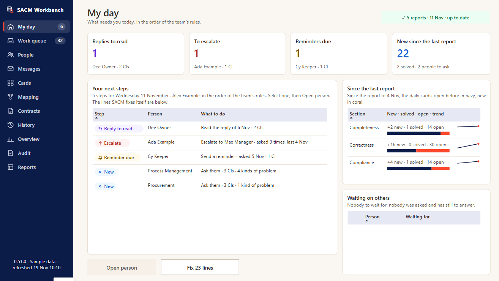
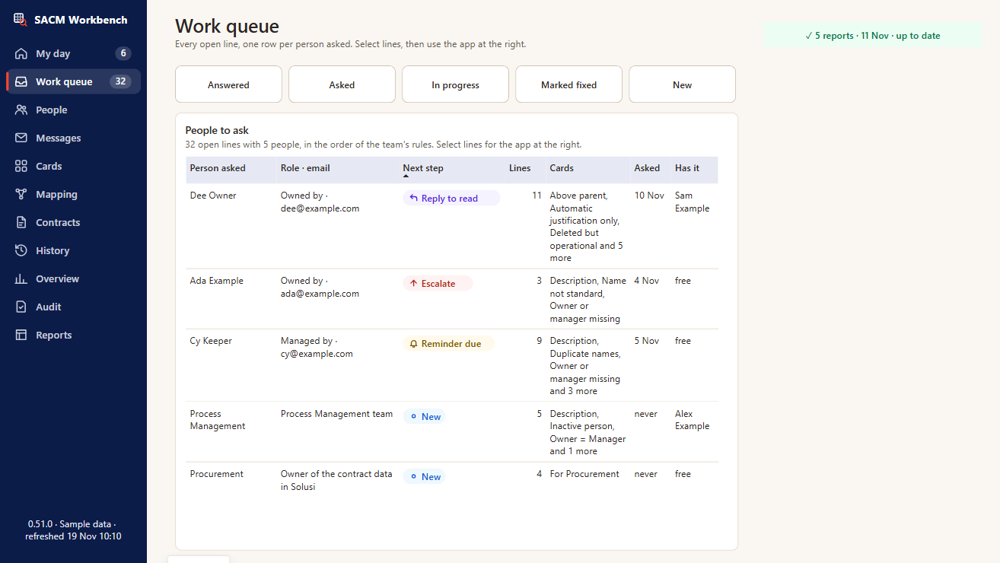
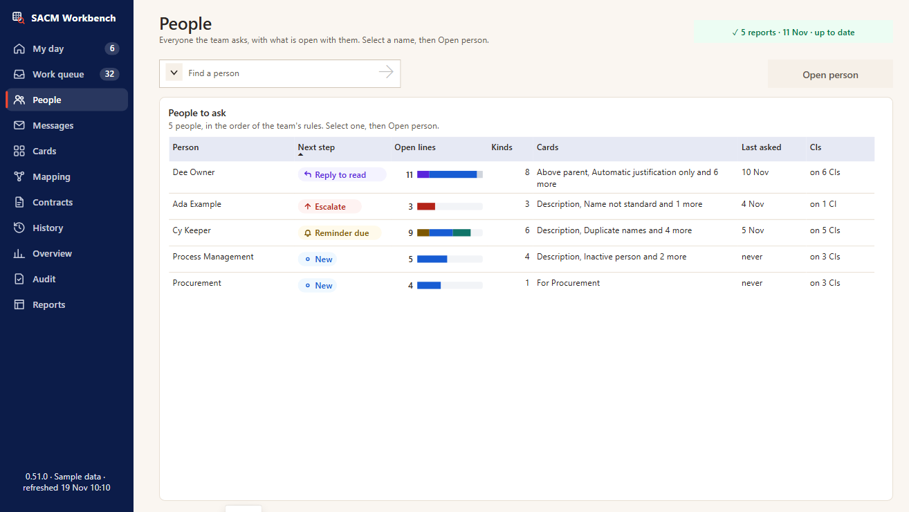
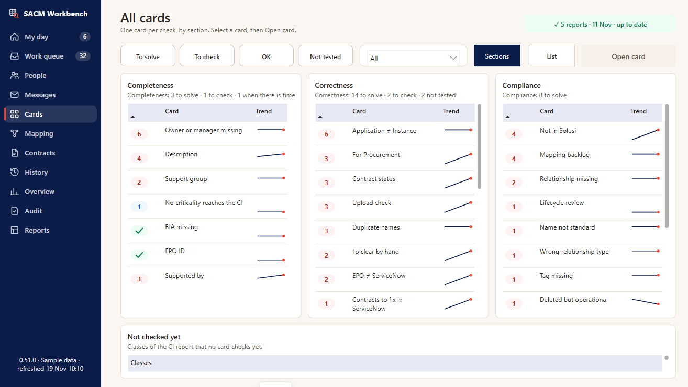
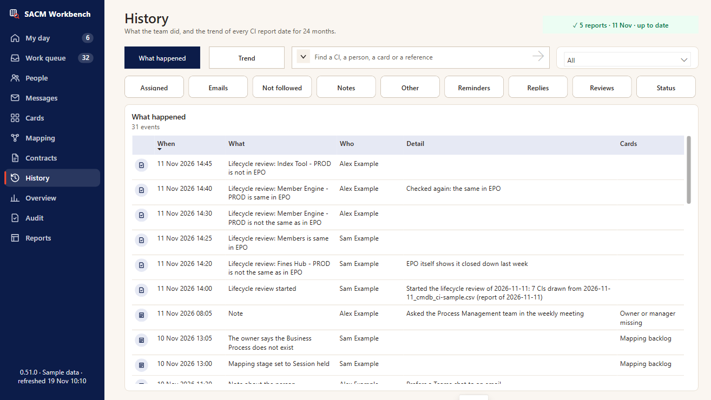
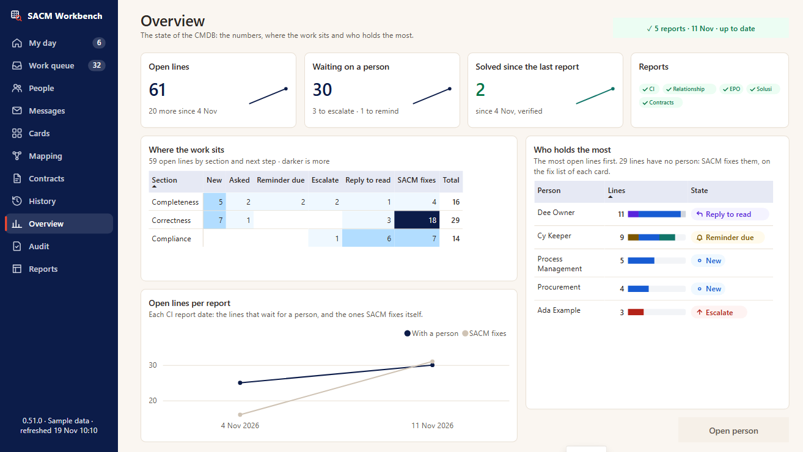
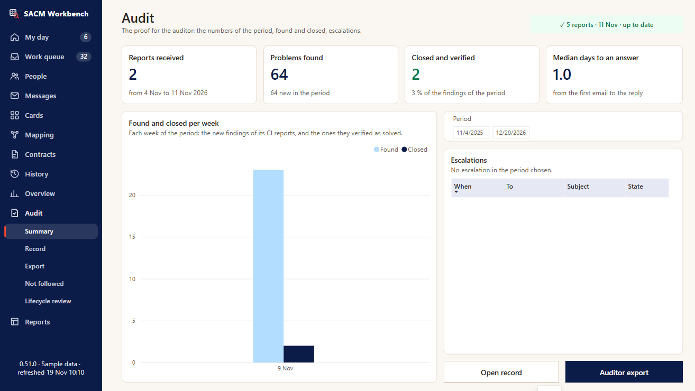
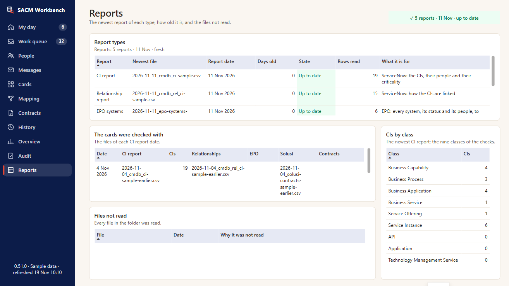

# How to use the report

This guide is for the SACM managers who use the report every day on app.powerbi.com. It shows each page and says what
to do there. The pictures come from the Desktop check of the report (decision D329). They show the invented sample
data, not real CIs or people. In the team's workspace the numbers are the real ones. The Power Apps (the buttons that
send, note and mark) are only in the published report, so the pictures show their place empty.

How the report is set up (the workspace, the lists, the apps and the flows) is in [README.md](README.md).

## 1. The parts of every page

- **The navy rail at the left** opens the pages. The page you are on is lighter, with a coral line. The number beside
  *My day* is how many next steps you have today. The number beside *Work queue* is how many lines are open. At the
  foot: the version, where the data comes from and when it was refreshed.
- **The chip at the top right** says whether the reports are up to date. Green: every report arrived in time. Amber:
  one is old or missing. Press it to open *Reports*.
- **The grey line under every title** says how many lines a box shows, or why it shows none ("Nobody to wait for").
  A box is never empty without a word.
- **Buttons on a row** (Open person, Open card, Open CI) work on the line you selected. They stay grey until you select
  a line; the grey line above them says so.
- **Tabs** (All cards, Card, Case, History) show one table at a time. A tab keeps the card, CI or person you opened.

## 2. Your day in five steps

1. **Open *My day*.** Four numbers: replies to read, people to escalate, reminders due, and what is new since the last
   report. Under them, **Your next steps**: one line per person, in the order of the team's rules (a reply first, then
   an escalation, a reminder, the people never asked).
2. **Select a step and press *Open person*.** The *Person* page shows the next step, the open lines, the last contact
   and everything open with them.
3. **Press *Prepare email*.** The page *Messages* opens with the email studio: the list of emails on the left, the email
   as it will arrive in the middle, and From, To, Cc and Subject on the right.
4. **Press *Send*.** The email goes out from the shared SACM mailbox, with the full list as a CSV file when it is long.
   The cases are recorded and the report refreshes. *Test to me* sends it to you only. *Outlook draft* puts it in your
   own Drafts, From the shared mailbox, to change it first.
5. **When a reply comes,** *My day* shows it first. Open the person: the app at the right opens on the tab *Reply*, with
   what they wrote next to their open lines. Tick the lines it answers and press *Mark answered*, or set *Waiting until*
   a date.

Nothing is sent on its own. Every email, reminder and escalation is a button you press.

## 3. The pages

### Work queue

Every open line, one row per person asked, with the next step, the lines, the cards, when they were last asked and who
in the team has them. The buttons at the top choose a status. Select rows, then use the app at the right: take them,
share them out, note, mark fixed.

### People

Everyone the team asks, in the order of the team's rules. The bar shows their open lines in the colours of the states.
*Find a person* searches the names. Select one, then *Open person*.

### Cards

One card per check, in three sections: Completeness, Correctness and Compliance. The badge is the number to solve (red),
to check (blue) or a tick when the card is fine (green). The small line is the last reports. The buttons at the top
choose the states, the list beside them a topic. The tab *List* shows the same cards as a table. Select a card, then
*Open card*: its tabs are *To solve with a person*, *SACM fix list*, *To check* and *Export*.

### History

*What happened*: everything the team did and every reply, newest first. Search for a CI, a person, a card or a
reference, or choose the kinds of event with the buttons. The tab *Trend* shows the open lines and the days to fix over
the reports.

### Overview

For the lead and the weekly meeting: the open lines, the lines waiting on a person and the lines solved, each with a
small line of the last reports; where the work sits (section by next step: darker is more); open lines per report; and
who holds the most. Select a person, then *Open person*.

### Audit

The proof for the auditor. Choose the **Period**. Four numbers (reports received, problems found, closed and verified,
the median days to an answer), found and closed per week, and every escalation. Under *Audit* on the rail are its
parts: *Record* (the verification record of a report date), *Export* (the tables to give the auditor: on a table,
*More options*, *Export data*), *Not followed* and *Lifecycle review*.

### Reports

The newest file of each kind of report, its date and whether it is up to date; the files each CI report date was checked
with; the files that could not be read; and how many CIs each class has.

### Mapping and Contracts

*Mapping* is the backlog of CIs to map, with the owner, the stage and the next step. *Contracts* compares the newest
Solusi file with the one before and lists the contracts that end soon. Both are for information: nobody is asked from
them.

## 4. When something looks wrong

- **The chip is amber.** A report is old or missing. Open *Reports*: it says which one. The numbers still show, from the
  reports that are there.
- **A box says why it is empty.** Read the grey line under its title: it is often fine ("No reply to read").
- **The numbers look old.** Look at the foot of the rail: it says when the data was refreshed. A refresh runs on its
  schedule and after a new report arrives.
- **A button stays grey.** Select a line first. In the app, the grey button says why under it.
